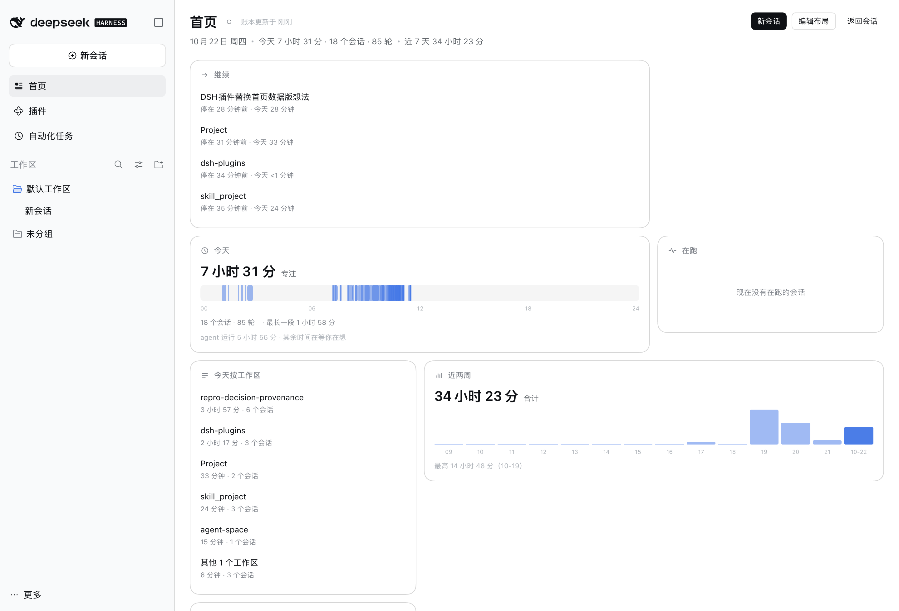
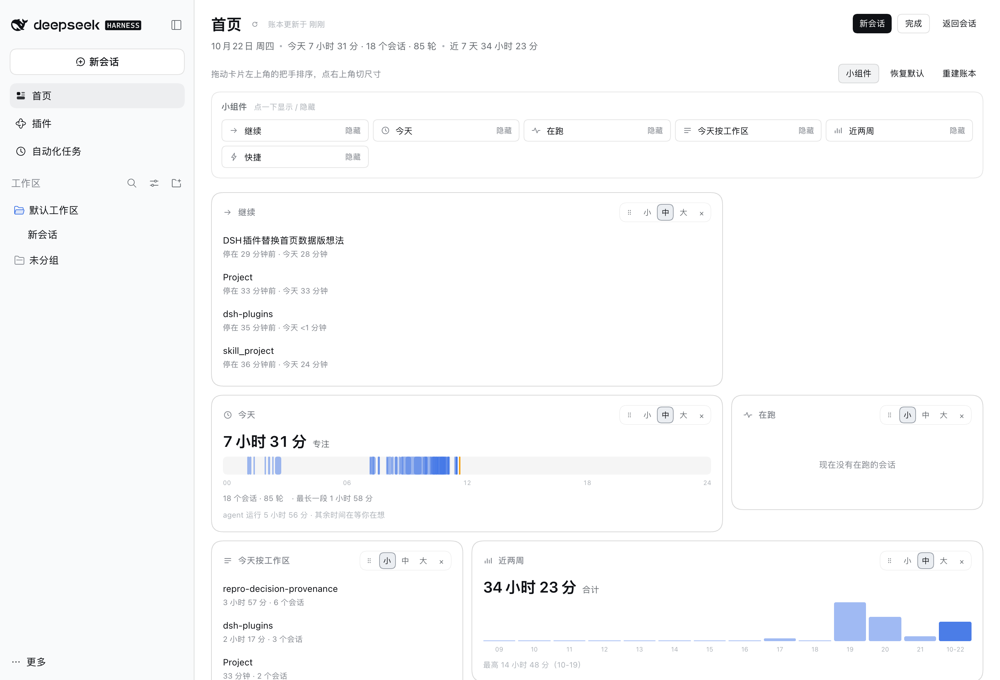

# dsh-home

<h1 align="center">dsh-home</h1>

<p align="center">跨工作目录找回会话，从常用任务草稿开始工作，再看看什么在等你。</p>

<p align="center">
  <a href="#"></a>
  <a href="#"></a>
</p>



## 这是什么

DSH 的"首页"其实是一次空白会话：logo + 一句标语 + 输入框。它每天都会被你看到，却不告诉你任何关于自己的事。

这个插件把**点左上角 logo** 改成打开工作台。首屏先展示两张可编排组件：

- **最近活跃会话**：跨工作目录列出会话标题、目录、短 ID、最近活动及状态；支持搜索、目录筛选、按尺寸分批展开，点击进入原会话。
- **常用任务**：开发功能、排查问题、审查改动、整理进展；选择已有工作目录或浏览其他目录，预填任务草稿。**不会自动发送，不会调用模型**；已有草稿会追加保留，需你检查后发送。

下面保留原来的三件事：

1. **回到现场**——最近在动的那条会话，带上次你说的话、停了多久、累计多久，点一下直接接上；
2. **在等我**——待审批、待回答、跑完了还没看的会话（来自官方 `sessionStatus`）；
3. **今天**——一条 24 小时时间带 + 一个主数字，不摆数字墙。

所有组件都属于同一张桌面，包括「回到现场 / 在等我 / 今天」。点击首页右上角 **编辑布局**，拖动标题自由摆放、右下角缩放；打开 **小组件**，把组件库中的标题或把手直接拖到桌面。同一种组件可多次拖入，每份配置独立。已移除 Add、桌面实例清单、隐藏和复制入口；桌面卡片右上角保留必要的内容编辑和确认删除。点击 **完成** 等待保存后退出；阅读模式不响应拖拽。旧布局兼容迁移，保留尺寸与显隐偏好。

它和用量统计类插件不重叠：那些回答"花了多少钱"，这页回答"我该接着干什么"。账本里没有 token，只有时间与现场。

## 安装

在 Web GUI 侧栏 **Plugins → 添加插件** 输入插件来源。下面的 Git 来源需已包含对应构建产物；**本文拖拽组件库原型对应本地开发版 0.13.2，不表示该版本已发布到 npm 或远端源码已更新**。

```sh
dsh plugin --profile web add "github:vlln/dsh-home"
```

装完**硬刷新浏览器**（Cmd/Ctrl+Shift+R）。只有 Node 半边（采集与路由）改动时才需要重启 DSH。

安装本地开发版本时，先构建，再使用本地 tarball。验证新功能请指定独立的 `DSH_HOME`，不要借用日常 GUI 的数据目录：

```sh
pnpm run build
pnpm pack
DSH_HOME=<isolated-home> dsh plugin --profile web add ./vlln-dsh-home-0.13.2.tgz
```

## 用起来

| 入口 | 行为 |
|---|---|
| 左上角 logo | 打开首页（原来的行为是"开新会话"） |
| 侧栏 `首页` 行 | 同上 |
| 首页右上「新会话」 | 开新会话（logo 原来的功能补在这里） |
| 首页右上「返回会话」 | 回到你进来之前那个会话 |

### 最近活跃会话与常用任务

会话列表合并宿主会话目录和活动账本，不必等完整历史索引结束。空白与子代理会话默认排除；同名目录显示可区分的路径后缀，悬停查看完整路径与会话 ID。搜索同时匹配标题、完整目录和 ID。小 / 中 / 大尺寸默认显示 3 / 6 / 10 条，可继续展开。

状态优先使用宿主实时数据；无法判断时显示「状态未知」，不把「没在运行」误称为「已完成」。这里的「最近」指会话更新或账本活动时间，不是浏览器访问历史。

任务模板是开始对话的草稿，不是自动执行脚本或 skill 安装器。「沿用当前 / 最近工作目录」由宿主选择；第一次使用可点「选择其他目录」。目录注册或导航失败时可以从侧栏重试；具体导航失败由宿主提示，模板不会代替你按发送。

### 三件事

| 卡 | 它回答什么 | 你能对它做什么 |
|---|---|---|
| 回到现场 | 我上次停在哪、停在哪一步 | 打开、换一个、先不看（dismiss） |
| 在等我 | 什么卡在我这里 | 打开、标记为已看过 |
| 今天 | 今天过了多久、时间花在哪些段 | 悬停时间带看每段明细 |

三张卡和其他组件一样，进入 **编辑布局** 后可跨位置拖动、改尺寸和删除，不再是单独的一套排序。

**记忆**：`自上次以来 N 个会话有动静` 只在真有新变化时出现在副标题；「先不看」记下时间戳，那条会话**有新活动后会重新出现**——看过了不等于永远别看。

### 编辑桌面与其他组件

以下类型同样可编排，可在编辑模式的组件目录中添加；已有实例可在卡片右上角编辑内容或删除：

- **在跑**：此刻有 agent 在跑的会话；
- **今天按工作区**：今天每个工作区的时长与会话数（含子代理时长，能对上"今天"的总数；超过 5 个补一行「其他 N 个工作区」）；
- **近两周**：每日活跃时长柱状；
- **快捷**：开新会话 / 回到上次会话，以及每份组件最多 8 个自定义会话、网页或工作目录入口。
- **工作足迹**：人工消息热力图，按浏览器时区归日，排除子代理和自动续轮；可筛选工作目录，点击日期查看对应会话。自动模式随宽度显示最近 12 周或一年，也可在设置中固定范围。历史未整理完整时明确提示，不把未知当作零活动。
- **便笺**：每张保存独立标题与纯文本，保留换行，不执行 HTML / Markdown。通过实例设置编辑，取消不写入；配置合计最多 8 KiB UTF-8 JSON。
- **时钟与日期**：默认跟随浏览器时区，也可设置如 `Asia/Shanghai` 的时区与 12/24 小时制；按分钟更新，支持多份世界时钟。

新增类型只出现在目录，不会自动占用或重排原桌面。「快捷」的旧实例原位升级，仍保留原来的新会话与继续入口；工作目录入口只打开未发送草稿，不执行任务。网页入口仅允许完整 HTTP(S) 地址，在新标签页打开。

点击首页右上 **编辑布局** 后，通过标题或把手拖动：组件实时跟随鼠标，预览框吸附网格，松手后落位。支持任意留白，不全局向上压紧；拖过已占区域不会立即挤动；在同一落点稳定停留约 0.5 秒才按悬停边缘让位：上侧向下、下侧向上、左侧向右、右侧向左。同时覆盖多张组件时沿同一碰撞轴撑开：上方同排一起上移、下方下移，左右镜像；保留同行同列与原相对顺序，不再换列自由重排。首选方向被画布边界挡住时，会尝试同轴的有序分流，不会仅因向上或向左无空间就直接拒绝。换落点或离开会重新计时，提前松手回原位。拖回原处，周围组件会恢复；松手才提交已确认的预演。靠近可视区域边缘可自动滚屏。拖右下角手柄调整宽高，内容较多时在卡片内部滚动。点击 **完成** 保存；保存失败时保留编辑状态供重试。桌面、平板、窄屏布局分别保存，调整一个断点不会覆盖另一个。



**Esc 分层退出**：先取消拖拽 → 关清单 → 保存并退出编辑。**键盘**：编辑时聚焦把手，用方向键逐格移动，碰撞时不移动；阅读模式不显示把手，也不响应拖拽。

### 多实例、设置与扩展

打开 **编辑布局 → 小组件**，侧边组件库可搜索名称、说明或来源，并按内置 / 扩展筛选。卡片使用与桌面相同的内容渲染，展示开发者提供的预览数据；没有预览数据时按空数据处理，不读取用户现场。拖动标题或把手到桌面，在空位直接松手；碰撞时稳定停留约 0.5 秒沿原逻辑让位，松手才创建实例。Esc、失焦或松在画布外不创建实例；没有额外点击放置模式。

右上角铅笔只在组件确实需要编辑内容时出现（如便笺内容、时区、快捷链接），保留统一草稿保存 / 取消。`×` 是确认删除，不再是隐藏。历史隐藏记录仍保留在文档中，不自动删除或恢复；此原型不再提供隐藏 / 复制 / 独立实例清单。首页画布使用可用内容宽度，主动留白与现有坐标保留。

组件库预览是受信任插件契约，不是浏览器安全沙箱。扩展必须识别 `props.preview` 并停用网络、定时器、导航和保存；旧扩展未适配时，inert 只能阻止交互，不能阻止其自带副作用。

第三方能力通过**独立代码插件**安装，不支持在首页粘贴或执行任意脚本。新扩展使用注入服务 `homeWidgets`：

```ts
import type { WidgetDefinition } from '@vlln/dsh-home/widgets'

// definition: WidgetDefinition<YourConfig>
ctx.inject(['homeWidgets'], scoped => {
  scoped.effect(() => scoped.homeWidgets.register(definition))
})
```

类型注册后出现在目录，由用户添加实例，不自动铺满桌面。扩展停用后保留实例与配置，显示缺失占位；重新安装同一类型可恢复。旧 `home.widget` 槽保留 `{ size }` 兼容，旧布局引用会迁移；新安装的旧式贡献也需从目录添加。

完整契约、可选服务依赖与打包方式见[小组件开发指南](<docs/widget-development.md>)；独立可安装示例见[计数器插件](<examples/widget-counter/README.md>)。每张卡有错误边界，但这**不是安全沙箱**：只安装可信来源的代码插件。

## 数据口径

时间指标由宿主折自会话日志，按**宿主本机时区**分日；**工作足迹单独按浏览器时区**统计顶层会话的 `user/message`（`source.kind=user`），每条人工消息计一次，附件消息也算，不按 `turn/start` 或 Token 计数。保留约 400 天的 UTC 分钟计数，展示最近 365 天；只统计当前宿主可见历史，不跨机器：

| 指标 | 定义 |
|---|---|
| 在场时长（专注） | 事件时间戳按 5 分钟空档聚簇，簇内跨度求和。挂机不产生事件，所以不会虚增 |
| agent 运行时长 | 每个 `step/start` → 匹配 `step/end` 的墙钟之和；与在场时长的差就是你在等/在想 |
| 轮次 | `turn/start` 的个数 |
| 「回到现场」的那句话 | 日志里最后一条**人类** `user/message` 的文本（截断到 160 字） |

- 数据是**观测式**的：插件启用后回扫既有会话，之后按日志 `revision` 增量重折；折叠口径有版本号，口径升级会整份重算。
- 历史很多时**不阻塞首屏**：按创建时间从新到旧分批折，卡片右上显示「正在整理 N/M」，随时可用。
- 空白会话不产生时长。
- 子代理会话单独记账，也计入「今天」的总量；「回到现场」只列顶层会话，「今天按工作区」把子代理时长并入其工作区。
- 数字是**估算**，不是账单：它衡量的是"有人动过多久"，不是计费。

## 已知限制

- **验收范围**：0.4.0 已通过本地测试、类型检查、构建和隔离宿主的真实任务草稿 / 目录 / 图标验证；多会话列表用合成账本验证，未读取真实历史。检查按阶段分次运行，不代表最终安装包的一次完整全量回归；原生目录选择仍需人工验收。
- **最近列表只覆盖当前宿主可见会话**，不会跨其他 `DSH_HOME` 或扫描其他机器。
- **常用任务依赖宿主草稿导航接口**；目录选择器只登记已有目录，不创建目录。请在发送前核对草稿与工作目录。

- **首次整理需要时间**：真实机器上可能有近千条会话、2 GB 日志（本项目验证时就是 974 条）。它分批在后台折，首屏只显示进度，但"今天按工作区/近两周"要等折完才完整。
- **「在等我」依赖官方 `sessionStatus`**：没有这个根钩子的组合里它永远是空的（卡片会显示"没有在等你的事"）。
- **没有 snooze 时长**：dismiss 只在会话有新活动时复活，不能"静音两小时"。
- **logo 的键盘语义没变**：点 logo 进首页，但 logo 仍是一个 `aria-label="New session"` 的按钮——键盘 Enter 还是开新会话，读屏读到的也还是"新会话"。折叠态侧栏上的 logo 依旧只负责展开侧栏。
- **macOS Desktop 没有 logo 入口**：官方桌面版里品牌那一行属于窗口拖动区，本来就不是按钮；桌面用户请用侧栏 `首页`。
- **旧时长卡的时区跟随宿主**：换时区后分桶要等下一次全量重折；工作足迹与时钟不受此限制，使用浏览器或所设时区。
- **不统计花销**，也不猜 token 单价。
- 账本文件不会随卸载自动删除，需要的话删 `$DSH_HOME/data/dsh-home/`。

## 插件管理

装/卸/启停用官方 CLI：`dsh plugin --profile web add|remove <包>`；已装插件在**侧边栏 Plugins 页**里查看与配置——每个插件自己的配置页挂在那个包页上（Settings 里的「插件」只是只读清单，改不了配置）。

## 兼容性

| dsh 版本 | 状态 |
|---|---|
| `0.2.1-rc.1` | 历史验证（2026-10-23，0.3.x）：三件事、记忆、展开与编辑布局、错误边界、分批扫描 |
| `0.2.1-rc.5` | 历史分阶段验证（2026-11-03，0.4.0 本地版）：安装指纹、缺依赖负控、工作台渲染、真实任务草稿与已有内容保留、零模型提交、图标；语言主题 / 窄屏 / 布局 / 合成会话交互分次检查，不代表该包完整全量回归 |
| `0.2.1-rc.5` | 小组件专项验证（2026-11-04，0.10.2 本地包）：独立示例发现与多实例、设置保存 / 取消、HTTP 500 重试、复制 / 隐藏 / 删除、12/6/2 列位置重载、旧槽兼容、配置迁移 / 缺失类型 / 未来文档只读保护；四组严格轴向与六组九卡拖动回归通过。官方 Plugins 页三轮停用 / 启用及定时器清零也已分次验证。原生触屏拖动与本轮中英文 / 深浅主题视觉矩阵未完整验证 |

本地版 `0.11.1` 的内置组件专项（2026-11-04，dsh `0.2.1-rc.5`）：227 项单测与真实隔离宿主 15 项验收通过；包含官方持久化合成历史、便笺 / 双时区 / 快捷入口、草稿保留与零模型发送、84 / 365 日格及键盘日期切换、英文浅色 / 中文深色、600px 窄屏。另跑四组严格轴向拖动回归。历史数据是合成夹具，不代表对用户全部历史的完整性审计；原生触屏手感仍需人工验收。

拖拽组件库原型 `0.13.2`：284 项单测通过；真实鼠标验证拖入、早松 / Esc / 画布外取消、静止碰撞让位、内容编辑与确认删除；预览零活动请求，计数器预览不启动定时器。原生触屏、窄屏抽屉与长距离边缘滚动未完整实测。旧回归脚本若仍依赖 Add / On desktop / 隐藏 / 复制，不适用于该原型；使用 `verify-library-drag.mjs`。

其它版本 ⚠️ 未验证。升级 dsh 后若出现 **面板还在但数字全是 0**，多半是宿主 `sessionPersistence` 服务改名（boot 日志会有 `dsh-home: pending (waiting for service: …)`）；若 **侧栏首页行消失**，多半是 `main` / `sidebar.panellist` 槽改名；若 **「在等我」永远为空**，多半是 `sessionStatus` 根钩子改名。

> 本插件不声明 `@deepseek-ai/dsh-*` 的 peer 范围，因此不会被宿主预检按版本整包禁用；它依赖的服务与槽名以上表实测版本为准。

## 许可

MIT
