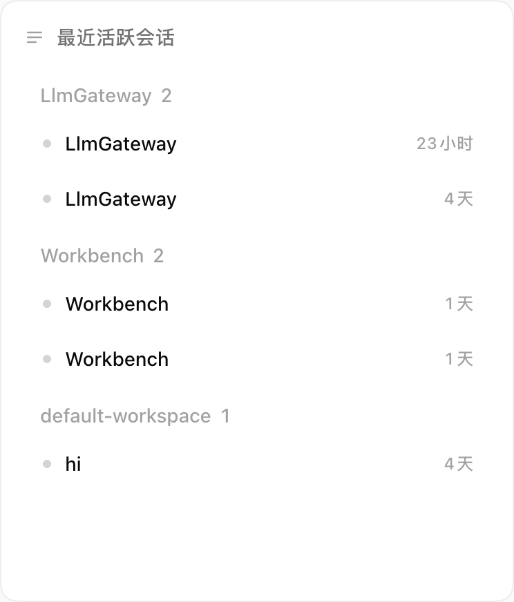
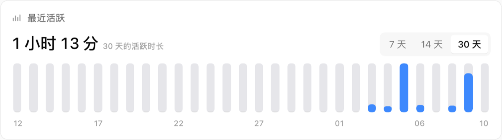

<p align="center">
  <picture>
    <source media="(prefers-color-scheme: dark)" srcset="docs/preview/home-dark.png">
    
  </picture>
</p>

<h1 align="center">dsh-home</h1>

<p align="center"><b>把 DSH 点 logo 打开的空白页换成一张可编排的桌面：十九种卡，覆盖会话、时间、计划与专注。</b></p>

<p align="center"><a href="#安装">安装</a> · <a href="#组件目录">组件目录</a> · <a href="#常见问题">常见问题</a></p>

<p align="center">
  <a href="package.json"></a>
  <a href="LICENSE"></a>
</p>

<p align="center"><sub>截图与视频取自隔离验证宿主，数据为合成夹具。</sub></p>

<br>

## 桌面与编排

DSH 原有的首页是一次空白会话：一句标语、一个输入框。装上这个插件后，点左上角 logo 打开的是上面那张桌面，卡片可以拖动、删除和重复添加。

下面这段视频是一次完整操作，从点 logo 到把新卡放上桌面：

https://github.com/user-attachments/assets/336a74e4-e08e-4713-abda-6f5b95dc329e

视频的操作顺序是：点左上角 logo 进入工作台 → 编辑布局 → 打开小组件 → 把「最近活跃」拖到桌面 → 松手落位。

拖动时卡片实时跟随指针，预览框吸附网格。拖过已占区域不会立刻挤动，在同一落点停留约 0.5 秒才按悬停的那条边让位；多张卡同时被碰到时沿同一轴撑开，同排同列不重排。

删除没有按钮也没有确认框：把卡片拖到页面顶部的删除目标，目标变红并写「松手即删除」，松手后卡片消失并播放碎屑动画，不可撤销。键盘等价路径是聚焦把手后按 Delete 或 Backspace。

尺寸是组件声明的形状集合。新建实例使用默认形状；保存过的宽度只在超出声明时收窄到最接近的声明宽度，高度从不迁移，避免撞上邻近的卡片。布局按屏幕断点分别保存，调整一个断点不覆盖另一个。

<br>

## 会话列表

<table>
<tr>
<td width="62%">
  
</td>
<td valign="top">
<p>最近活跃会话列出最近 5 条，每条两行：第一行是状态点、标题与相对时间，第二行是工作区胶囊。</p>
<p>只有「在等你」把状态写成文字，其余状态由状态点表达。卡片上不放搜索框与目录下拉，检索与翻历史在侧栏完成。</p>
<p>列表覆盖当前宿主可见的会话，不跨其他数据目录。</p>
</td>
</tr>
</table>

<br>

## 时间统计

<table>
<tr>
<td width="62%">
  
</td>
<td valign="top">
<p>最近活跃显示每天投入的时长：一个主值加一排日柱，7 / 14 / 30 天三个窗口就地切换。这三个窗口是同一个量的不同切面，所以合成一张卡。</p>
<p>在场时长按事件聚簇计算，五分钟没有动静不计入，挂机不虚增。</p>
<p>工作足迹是另一种切面：按顶层的真人消息计数，按浏览器时区归日，点某天查看当天会话。</p>
</td>
</tr>
</table>

<br>

## 组件目录

十九种卡，尺寸是声明的：只有列出的形状存在，没有拖边框改尺寸的入口。表里是拖入时的默认形状，`4` 约等于 372px。

| 卡 | 它回答什么 | 默认 |
|---|---|---|
| 最近活跃会话 | 今天刚动过哪几个会话，最近 5 条 | 4×8 |
| 置顶会话 | 原生全局置顶列表，点进去回到原会话 | 4×8 |
| 会话状态 | 在跑 / 在等你 / 未读三档，等你的人写明原因 | 4×6 |
| 今天 | 一条 24 小时时间带加一个主数字 | 8×4 |
| 最近活跃 | 每天投入的时长，7 / 14 / 30 天 | 8×4 |
| 工作足迹 | 人工消息热力图，点某天看当天会话 | 8×6 |
| 待办 | 今天 / 本周 / 更远 / 无日期 / 已完成分组，回车落在今天 | 4×6 |
| 今日计划 | 今天的时间轴，「现在」线插在正确位置 | 4×6 |
| 日程 | 月视图加所选日期的条目，可在那天直接新建 | 4×8 |
| 打卡 | 今天该做的习惯与连续天数 | 4×6 |
| 计时器 | 倒计时圆盘，圆盘本身是设置器（拖动或滚轮） | 4×4 |
| 番茄钟 | 25 分钟专注、5 分钟休息，记今日轮数 | 4×6 |
| 倒计时 | 最多 8 个目标日期，显示最近一个还剩多久 | 4×4 |
| Token 用量 | 今天用了多少、七天走势、缓存命中率、输出速率 | 4×6 |
| 余额 | DeepSeek 平台余额与今日花费，key 只在宿主侧使用 | 4×4 |
| 图片 | 一张图加可选标题，http(s) 或本地路径 | 4×4 |
| 一句话 | 中英文语录按日轮换，也可换成自己的清单 | 4×4 |
| 便笺 | 在卡上直接写，首行即标题，停笔即保存 | 4×6 |
| 时钟与日期 | 大号时间、日期牌、一行安静的时区小字 | 4×4 |

计划、计时、账本与余额都存在本机，写在插件自己的数据目录：`state.json` 存布局，`planner.json` 存待办与日程（四张卡共用一份），`focus.json` 存计时，`ledger.json` 是时间账本，`pictures/` 放图片卡上传的文件。写入走 op 式接口：客户端只发操作，宿主在现有文档上应用，两个窗口同时改不会互相覆盖。

<br>

## 安装

> **前提：** 本机已安装 DSH（`dsh` 命令可用）与 Node ≥ 22.19。

1. 装进 web profile：

   ```sh
   dsh plugin --profile web add @vlln/dsh-home
   ```

2. 硬刷新浏览器（Cmd/Ctrl+Shift+R）。只有 Node 半边改动时才需要重启 DSH。

3. 点左上角 logo 进入工作台。顶栏右上出现「编辑布局」与「返回会话」，即为安装完成。

| 安装方式 | 适用环境 | 入口 | 额外条件 |
|---|---|---|---|
| npm | 日常使用 | `dsh plugin --profile web add @vlln/dsh-home` | 能装公共 npm 包 |
| 本地 tarball | 改代码、验证新功能 | `npm run build && npm pack`，再 `dsh plugin --profile web add ./vlln-dsh-home-<version>.tgz` | 用独立的 `DSH_HOME`，不借用日常数据目录 |

卸载用 `dsh plugin --profile web remove @vlln/dsh-home`。桌面布局、计划与账本留在 `$DSH_HOME/data/dsh-home/`，不随卸载删除。

<br>

## 依赖与数据

插件不收费，不带账号、埋点与上报。下表是它接触外部世界的地方：

| 能力 | 需要什么 | 不配置会怎样 |
|---|---|---|
| 工作台、计划、计时 | 本机 DSH | — |
| 会话列表与时间账本 | 宿主已有的会话历史 | 列表为空、数字为 0，卡片不报错 |
| 余额与今日花费 | DeepSeek 平台 API key，宿主侧解析（设置里的 `apiKeyEnv` 或 `DEEPSEEK_API_KEY`） | 卡片写「未配置 API key」，不显示旧值 |
| 图片 | 本地文件（宿主只读路由读出）或 http(s) 地址 | 空槽显示虚线框 |

> **数据：** 时间、计划、布局与计时全部落在本机 `$DSH_HOME/data/dsh-home/`。除余额用 key 请求 DeepSeek 平台、图片卡可能引用外链之外，插件不发起对外请求。

<br>

## 兼容性

| 依赖 | 状态 |
|---|---|
| dsh `>= 0.2.0` | 声明在 `package.json` 的 `engines`；不声明 `@deepseek-ai/dsh-*` 的 peer 范围，因此不会被宿主预检按版本整包禁用 |
| Node `>= 22.19` | 同上 |
| dsh `0.2.1-rc.5` | 本版实测：单测、类型检查、构建、隔离宿主 16 项（中英 × 深浅四档、760px 窄屏） |

宿主服务或槽位改名时，症状比版本号好认：

| 症状 | 多半是 |
|---|---|
| 面板还在，数字全是 0 | `sessionPersistence` 服务改名（boot 日志有 `dsh-home: pending (waiting for service: …)`） |
| 侧栏「首页」行消失 | `main` / `sidebar.panellist` 槽改名 |
| 会话状态只有「在跑」 | `sessionStatus` 根钩子改名 |
| 计时器写「未能保存」 | 宿主服务端是旧版本，没有计时写入能力，重启宿主 |

<br>

## 常见问题

<details>
<summary>为什么没有拖边框改尺寸的入口？</summary>

尺寸是组件声明的形状集合，不是自由数值。同一张卡在任何桌面上保持同样的比例，不会因为拉宽变成另一种版式；需要别的形状时，从组件库再拖一张。

</details>

<details>
<summary>需要联网或账号吗？</summary>

不需要账号。会话、时间、计划与计时都读本机会话历史与本机文件。外部请求只有两处：余额卡（配置了 key 才会发）和图片卡里引用的外链。

</details>

<details>
<summary>多张卡会拖慢页面吗？</summary>

每张卡只订阅一份共享数据，数据变化时同一帧一起重渲染。计时器运行期间按帧更新圆盘，暂停后不再重绘；账本首次整理在后台分批折叠，首屏只显示进度。

</details>

<details>
<summary>怎么加自己的卡？</summary>

第三方卡是独立的代码插件，注入 `homeWidgets` 服务注册，不需要改这个仓库。契约与打包方式见[小组件开发指南](docs/widget-development.md)，可安装的示例见[计数器插件](examples/widget-counter/README.md)。卡片有错误边界，但不是安全沙箱：只安装可信来源的代码插件。

</details>

<br>

## 开发

```sh
npm run build      # 主题 CSS → 资产校验 → 打包 client/host → 类型检查
npm test           # 单测：纯逻辑、契约、静态门禁
npm run check      # 上面两件事加资产校验，提交前的门
npm run test:host  # 隔离宿主验收：先 npm pack，再传 --tarball
```

| 文件 | 读它做什么 |
|---|---|
| [docs/widget-development.md](docs/widget-development.md) | 扩展契约、预览、尺寸声明、打包 |
| [docs/boardui-conformance.md](docs/boardui-conformance.md) | 视觉标准的实测数字与层序陷阱 |
| [docs/conformance-plan.md](docs/conformance-plan.md) | 每张卡的设计取舍 |
| [docs/release.md](docs/release.md) | 发布前的检查清单 |
| [CHANGELOG.md](CHANGELOG.md) | 版本变更 |

<br>

## License

[MIT](LICENSE)。vendored 的界面组件与第三方依赖的条款见 [THIRD_PARTY_NOTICES.md](THIRD_PARTY_NOTICES.md)。
